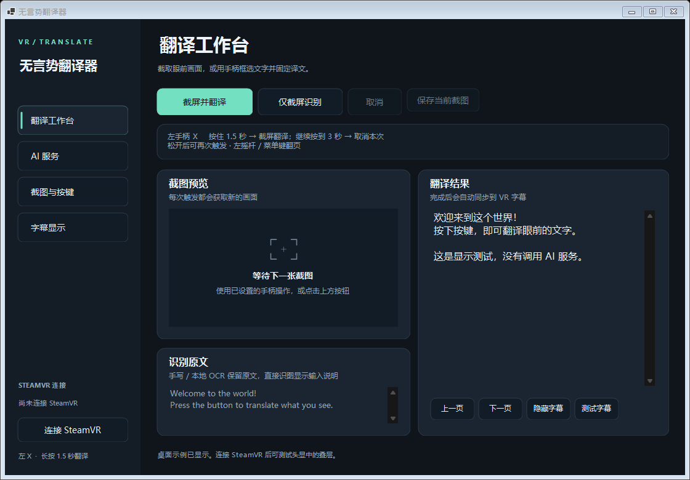

# Mugonzei Honyakuki

**無言勢翻訳機 · 无言势翻译器**

[简体中文](README.md) · [日本語](README.ja.md) · [English](README.en.md)

Read the text in front of you in SteamVR: hold a controller button to capture the view, recognize handwritten or printed text, and display the translation in a translucent subtitle bar below your line of sight. Designed for nonverbal communication, it can also help with in-game signs, menus, and chat text.

[Download for Windows](https://github.com/pan0001/mugonzei-honyakuki/releases) · [Report an issue](https://github.com/pan0001/mugonzei-honyakuki/issues)



> Experimental Windows x64 application. Handwriting recognition can misread or omit characters; check the result against the original image. This project is independent of SteamVR, VRChat, and the AI service providers.

## Features

- **Controller capture:** hold the left X button for 1.5 seconds to trigger a capture. A ring below your view shows progress. Continue holding until 3 seconds to cancel the current task and hide the subtitles.
- **Subtitle overlay:** a wide, low-profile translucent bar with pagination, optional source text, and adjustable position, width, and display duration.
- **AI handwriting recognition:** automatically locate writing, crop and enlarge details from the original image, read them alongside the full image, then translate. Intended for Chinese, Japanese, English, and mixed text, without manual region selection.
- **Direct image analysis:** send the screenshot directly to a vision model, which organizes the translation or a brief explanation to suit the image.
- **Local OCR:** Tesseract for printed text and a separate NDLOCR-Lite engine for Japanese recognition. The recognition stage can run locally.
- **Multiple translation services:** an existing Codex login, cloud or local OpenAI-compatible APIs, and a background Google Translate webpage.
- **Optional region selection:** use both controllers to draw a rectangle, translate only that region, and keep the result fixed in SteamVR tracking space.
- **Save problem samples:** manually save the current screenshot from the workspace. Normal use does not automatically create a screenshot or translation history.

## Requirements

- Windows x64, SteamVR, and a headset and controllers that work through SteamVR.
- Codex mode: an installed Codex CLI with an active login. It calls an online model; inference is not offline.
- Other AI APIs: an available compatible service. Image analysis requires image input support, and AI handwriting mode also requires support for multiple images in one request.
- Google Translate webpage mode: an internet connection and Microsoft Edge WebView2 Runtime.
- The portable package includes the .NET runtime, Tesseract language models, and the local Japanese OCR runtime. Building from source requires the .NET 10 SDK and an internet connection when preparing dependencies for the first time.

The desktop interface is currently mainly in Simplified Chinese. This repository provides documentation in Chinese, Japanese, and English. Chinese UI labels are retained below so you can find the corresponding controls.

## Quick start

1. Download the Windows archive from [Releases](https://github.com/pan0001/mugonzei-honyakuki/releases) and **extract the entire archive** into a writable directory. Do not copy just the `.exe`.
2. Start SteamVR, connect your headset, enter the game, then run `SteamVrTranslator.exe`.
3. In 「AI 服务」 (AI Services), choose a translation service and recognition mode, set the target language, and click 「保存设置」 (Save Settings). The initial configuration defaults to local Codex + local OCR; it does not automatically upload screenshots to a model.
4. To use Codex for image recognition, choose 「直接发送截图给模型」 (Send Screenshot Directly to Model) or 「手写体 OCR（AI）→ 翻译」 (AI Handwriting OCR → Translation). You can enter `gpt-6.1-terra` as the model and select `low` for reasoning effort, subject to the models actually available to your account.
5. Face the text and hold the left X button. **When the ring fills at 1.5 seconds, the app captures the view and starts translation.** Release the button and wait for the subtitles. Recognition and translation take additional time; the hold timer is not the total waiting time.
6. If you no longer need that translation, keep holding until **3 seconds**. When the second ring fills, the task is canceled and the subtitles are hidden. Release the button before holding it again to take a new screenshot.

「检测 Codex 登录」 (Check Codex Login) only checks login status. 「测试字幕」 (Test Subtitles) only displays a fixed example sentence. Use a recognition button to check the source text first; AI recognition buttons still send images. Minimizing keeps the app in the system tray; closing the window exits the app.

If `VCRUNTIME140.dll` or `MSVCP140.dll` is missing, install Microsoft's [Visual C++ x64 Redistributable](https://aka.ms/vs/17/release/vc_redist.x64.exe). For installing the runtime required by Google webpage mode, see [Microsoft WebView2](https://learn.microsoft.com/en-us/microsoft-edge/webview2/concepts/distribution).

## Choosing a recognition mode

| Mode in the UI | Processing flow | Where images go |
| --- | --- | --- |
| 本地 OCR → 文字翻译 (Local OCR → Text Translation) | Tesseract recognition, followed by text translation | Recognition stays on your computer; only the source text is sent to the translation service |
| 直接发送截图给模型 (Send Screenshot Directly to Model) | A vision model reads and translates the image, choosing its own output format | The screenshot is sent to the selected Codex / API service |
| 手写体 OCR（AI）→ 翻译 (AI Handwriting OCR → Translation) | Automatic region detection → reading enlarged details → translation | The full image and detail images are sent to the selected Codex / API service |
| 本地日语手写 OCR → 翻译 (Local Japanese Handwriting OCR → Translation) | Local NDLOCR-Lite recognition, followed by text translation | Recognition stays on your computer; only the source text is sent to the translation service |

AI handwriting recognition usually makes two vision requests, with one additional text request for translation. It therefore takes more time and usage than a single direct image request. Enlarging an image cannot restore strokes that are blurred, obscured, or missing from the original. NDLOCR-Lite's Japanese recognition capability does not mean it can correctly recognize all mixed Chinese, Japanese, and English handwriting.

## Configuring a translation service

### Codex

The app uses the Codex CLI's existing login; you do not need to enter an API key here. Leave the executable path blank for automatic detection. Leave the model blank to use the CLI's default selection. The app does not inherit the model setting from your personal `config.toml` or continue an existing chat.

「思考程度」 (Reasoning Effort) supports 「自动（按阶段）」 (Automatic by Stage), `low`, `medium`, and `high`. Automatic uses low for direct image analysis and text translation, medium for locating handwriting, and high for reading multiple views in detail. An explicit selection overrides every Codex recognition and translation stage. Save changes before using them. Calls count toward your account usage; account permissions, limits, and network conditions affect availability.

### Cloud or local API

Select 「其他 AI API」 (Other AI API), then enter a Base URL or full `/chat/completions` URL, the model name, and any key required by the service. Chat Completions JSON/SSE responses are supported. Images are sent as PNG data URLs in `image_url` items. In streaming mode, subtitles appear after the full response is received; they do not update character by character.

Use a provider preset or enter a compatible address yourself. The local presets are:

- Ollama: `http://localhost:11434/v1/`
- LM Studio: `http://localhost:1234/v1/`

Start the local service and load a suitable model yourself first. You can leave the key blank if authentication is disabled. This app does not automatically download or start models, and it does not automatically switch to a cloud service on failure. The Codex reasoning effort setting does not affect these APIs.

「测试图片识别」 (Test Image Recognition) sends a fixed image generated by the app, not your current game view. When switching service addresses, enter the model and key for that service again. Unsaved AI settings block new recognition requests.

### Background Google Translate webpage

Select 「Google Translate（后台网页）」 (Google Translate — Background Webpage) together with local OCR or local Japanese OCR. The app enters recognized text into a separate WebView2 page and reads the translation. No API key is required. This is neither Gemini nor the Google Cloud Translation API.

The webpage works in the background by default, without using desktop mouse automation to enter text. 「查看翻译网页」 (View Translation Webpage) shows the page. Each request is limited to 5,000 characters. CAPTCHAs, rate limits, access denials, or changes to the webpage may cause translation to fail. The app does not bypass verification or automatically switch services.

## Controls and subtitles

| Action | Default binding |
| --- | --- |
| Capture and translate with Touch / Quest through SteamVR | Hold left X for 1.5 seconds; continue to 3 seconds to cancel |
| Capture and translate with Index | Hold left A for 1.5 seconds; continue to 3 seconds to cancel |
| Capture and translate with Vive | Hold the right menu button for 1.5 seconds; continue to 3 seconds to cancel |
| Change subtitle page with a controller | Touch / Index: click the left thumbstick; Vive: left menu button |
| Capture and translate with the keyboard | `Ctrl+Alt+T` |
| Next page / previous page | `Ctrl+Alt+→` / `Ctrl+Alt+←` |
| Show or hide the last subtitles | `Ctrl+Alt+H` |

If the translation shortcut is already in use, the app tries `Ctrl+Alt+F8`, `Ctrl+Alt+F9`, then `F8`. The active binding is shown at the bottom of the window. Open the SteamVR binding editor from 「截图与按键」 (Capture and Controls) to change controller bindings. The app does not suppress the same button's input in the game.

A new screenshot replaces the previous task. Late results from a canceled task cannot overwrite newer subtitles. The app briefly hides its own overlays while capturing to keep its ring and subtitles out of the screenshot.

## Optional: two-controller region selection

In 「截图与按键」 (Capture and Controls), enable 「双手柄框选」 (Two-Controller Region Selection) and save. Hold left X and point the left and right controllers at opposite corners of a rectangle. **Release X** to capture and translate the selected region. This mode replaces the controller's 1.5-second / 3-second hold behavior. Keyboard and desktop buttons still take normal screenshots.

The frame is fixed in SteamVR tracking space. It does not automatically follow game objects, thumbstick movement, or teleportation, and it has no depth occlusion from the game scene. Fast movement, tracking loss, or older custom action bindings can affect region selection. Turn this option off to restore normal screenshots and subtitles below your view.

## Data and privacy

- Settings are stored in `%LOCALAPPDATA%/SteamVrTranslator/`. API keys are encrypted with DPAPI for the current Windows user. Codex login is managed by the CLI itself.
- Cloud vision models receive screenshots. With local OCR, only the recognized text is sent to the selected translation service. The entire process can be offline only when both recognition and translation use local services.
- Codex and local Japanese OCR create temporary PNG files and attempt to clean them up on completion, failure, or cancellation. Forced termination or a power outage can leave temporary files behind.
- The Google webpage uses a separate `GoogleWebView2/` data directory. It does not share your personal browser login, but it retains website cookies and cache.
- Normal use does not automatically save screenshots or translation history. 「保存当前截图」 (Save Current Screenshot) is a manual user action. Development diagnostic commands separately write images, source text, or result reports.
- Redact private information before submitting an issue. Do not upload settings, credentials, personal screenshots, or entire diagnostic directories.

## Building from source

After installing the .NET 10 SDK and Git on Windows x64:

```powershell
git clone https://github.com/pan0001/mugonzei-honyakuki.git
cd mugonzei-honyakuki
.\build.ps1
```

The script prepares missing OCR resources, runs tests, and creates a self-contained release directory at `dist/SteamVrTranslator/`. The local Japanese runtime is installed in a private project directory without changing global Python. NDLOCR-Lite is pinned to 1.3.1. See the preparation scripts and generated runtime manifest for model and dependency sources and verification details.

To run the tests or UI demo separately:

```powershell
dotnet run --project tests/SteamVrTranslator.Tests.csproj -c Release
.\dist\SteamVrTranslator\SteamVrTranslator.exe --demo
```

The regular automated tests use fixed samples and mock services. `--demo` does not automatically connect to SteamVR or call AI. Diagnostics such as `--codex-smoke`, `--vision-smoke`, and `--handwriting-smoke` call real models and may consume account usage; do not treat them as offline tests.

## Known limitations and feedback

Handwriting, small text, perspective, reflections, and complex backgrounds can cause incorrect or missing characters, or include unrelated background text. Tests on development samples do not establish accuracy in real use. SteamVR controller input, headset readability, and service compatibility need to be checked with the actual devices and services. Google webpage mode may stop working when the webpage changes.

When reporting a problem, include the application version, recognition mode, service name, controller type, and steps to reproduce it. If you choose to provide an image, crop out unrelated or private content first, and include the correct source text and the incorrect result.

## Third-party components

The main components are OpenVR, Vortice.Windows, Tesseract, NDLOCR-Lite, .NET, and WebView2. Each component is subject to its own license. See [THIRD-PARTY-NOTICES.md](THIRD-PARTY-NOTICES.md) and the license files retained with the source or release package. In particular, NDLOCR-Lite and its model-related components must not be described as having a single shared license.
