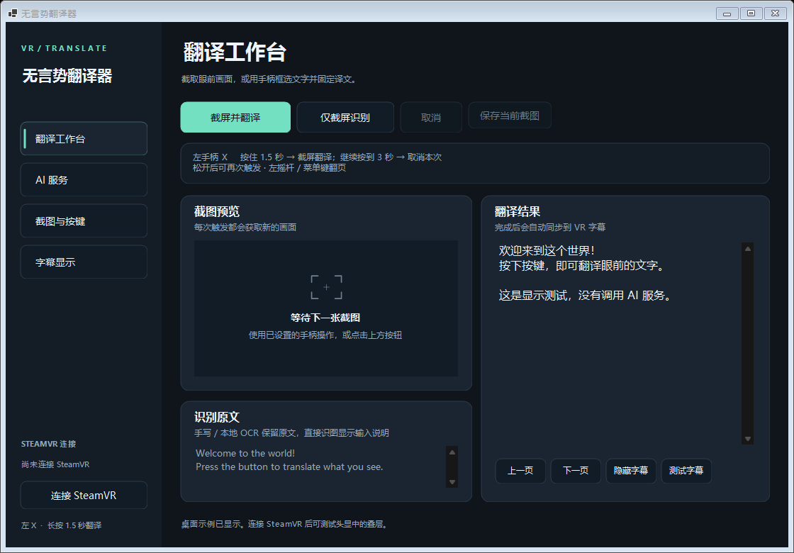

# 無言勢翻訳機

**无言势翻译器 · Mugonzei Honyakuki**

[简体中文](README.md) · [日本語](README.ja.md) · [English](README.en.md)

[公式サイト](https://mugonzei.top) · [アカウントページ](https://mugonzei.top/account.html)

SteamVRで、目の前の文字を読めるように。コントローラーのボタンを長押ししてスクリーンショットを撮影し、手書き文字や印刷文字を認識して、訳文を視界の下部に半透明の字幕バーで表示します。無言でのコミュニケーションを想定しており、ゲーム内の看板、メニュー、チャットの文字にも使えます。

[Windows版をダウンロード](https://github.com/pan0001/mugonzei-honyakuki/releases) · [不具合を報告](https://github.com/pan0001/mugonzei-honyakuki/issues)



> 実験的なWindows x64アプリです。手書き文字の認識では読み間違いや文字の抜けが生じることがあります。元の画像と照らし合わせて確認してください。本プロジェクトはSteamVR、VRChat、および各AIサービス提供者とは独立しています。

## できること

- **コントローラーで撮影**：左手のXボタンを1.5秒長押しすると撮影します。視界の下部にあるリングで進行状況を確認できます。そのまま3秒まで押し続けると、今回の処理をキャンセルして字幕を非表示にします。
- **字幕オーバーレイ**：横長の半透明字幕バー。ページ切り替え、原文との比較、位置・幅・表示時間の調整に対応しています。
- **AIによる手書き文字認識**：文字の位置を自動で特定し、元画像から切り出して拡大した画像と画像全体を使って原文を読み取り、翻訳します。中国語・日本語・英語、およびそれらが混在した文字を対象としており、手動で範囲を選択する必要はありません。
- **画像を直接読み取り**：スクリーンショットを視覚モデルに直接送り、画面の内容に応じて訳文や短い説明を生成します。
- **ローカルOCR**：Tesseractによる印刷文字認識と、独立したNDLOCR-Liteによる日本語認識を利用できます。認識段階はPC内で処理できます。
- **複数の翻訳サービス**：ログイン済みのCodex、クラウドまたはローカルのOpenAI互換API、バックグラウンドで動作するGoogle翻訳のWebページに対応しています。
- **アカウントとクレジット**：クレジットサーバーに接続して、注文・利用履歴を確認できます。運営者がチャージを開始した後は、愛発電で利用回数パックを購入できます。翻訳が最後まで成功すると1クレジットを消費します。自分で用意したサービスでは消費しません。
- **任意の範囲選択**：両手のコントローラーで長方形を作り、選択範囲だけを翻訳できます。結果はSteamVRのトラッキング空間に固定されます。
- **不具合調査用サンプルの保存**：作業パネルから現在のスクリーンショットを手動で保存できます。自分で用意したサービスでは翻訳履歴を作成しません。クレジットサーバーは切断後の復元用に最近の結果を保存します。

## 動作要件

- Windows x64、SteamVR、およびSteamVRで使用できるヘッドセットとコントローラー。
- Codexモード：インストール・ログイン済みのCodex CLI。オンラインのモデルを呼び出すため、オフライン推論ではありません。
- その他のAI API：利用可能な互換サービス。画像の読み取りには画像入力への対応が必要で、AI手書きモードには複数画像の入力への対応も必要です。
- Google翻訳Webページモード：インターネット接続とMicrosoft Edge WebView2 Runtime。
- ポータブルパッケージには、.NETランタイム、Tesseractの言語モデル、ローカル日本語OCRのランタイムを同梱しています。ソースからのビルドには.NET 10 SDKが必要で、依存関係を初めて準備する際にはインターネット接続が必要です。

現在、デスクトップUIは主に簡体字中国語です。このリポジトリでは中国語・日本語・英語の説明を提供しています。

## クイックスタート

1. [Releases](https://github.com/pan0001/mugonzei-honyakuki/releases)からWindows用の圧縮ファイルをダウンロードし、書き込み可能なフォルダーに**すべて展開**します。`.exe`だけをコピーしないでください。
2. SteamVRを起動してヘッドセットを接続し、ゲームに入ってから`SteamVrTranslator.exe`を実行します。初回起動時には、3ステップの設定ウィザードが自動で開きます。
3. ステップ1ではサービスのカードを選びます。上から「账号积分服务（推荐）」（アカウントのクレジットサービス・推奨）、「使用自己的 API 服务」（自分のAPIサービスを使用）、「连接本机 Codex」（PC上のCodexに接続）、「本地 OCR + Google 翻译」（ローカルOCR＋Google翻訳）の順です。初回はクレジットサービス、`https://api.mugonzei.top`、「手写体 OCR（AI）→ 翻译」（手書きOCR〈AI〉→翻訳）が選択されています。カードを選ぶだけでは画像送信やモデルの呼び出しは行いません。
4. ステップ2でサービスへの接続を設定し、画像認識方式と翻訳先の言語を確認します。クレジットサービスでは「登录 / 注册 / 兑换积分」（ログイン／登録／コード引き換え）からアカウント画面を開き、運営者から受け取ったコードを引き換えられます。「使用其他积分服务器」（別のクレジットサーバーを使用）を選ぶと、自分で運用するサービスのアドレスに変更できます。自分のAPIではアドレスとモデルが必須ですが、認証を無効にしたローカルサービスではキーを空欄にできます。Codexのモデルは空欄にでき、思考レベルの既定値は「自动（按阶段）」（自動〈段階別〉）です。Googleを選ぶと非対応のAI認識方式はローカルOCRに切り替わり、ローカルOCRまたはローカル日本語OCRとのみ組み合わせられます。ウィザードやアカウント画面を開くだけでは、自動ログインや通信は行いません。
5. ステップ3で撮影元を選択し、ショートカットキー、VRコントローラーの設定、設定内容のまとめを確認して、「保存并进入工作台」（保存して作業パネルを開く）をクリックします。完了後に初めて作業パネルが開き、SteamVRへの接続とショートカットキーが有効になります。
6. 文字に視線を向け、左手のXボタンを押し続けます。**1.5秒でリングが一周すると撮影され、翻訳を開始します**。そこでボタンを離し、字幕が出るまで待ってください。認識と翻訳には別途時間がかかります。長押し時間は、結果が出るまでの総待ち時間ではありません。
7. 今回の翻訳が不要な場合は、そのまま**3秒**まで押し続けます。リングの2周目が完了すると処理をキャンセルし、字幕を非表示にします。一度ボタンを離してから再び長押しすると、新しいスクリーンショットを撮影できます。

初回設定を完了せずにウィザードを閉じるとアプリは終了し、次回起動時に再び表示されます。既存の設定は自動で引き継がれ、再設定を求められることはありません。必要な場合は「AI 服务」（AIサービス）ページの「配置向导」（設定ウィザード）から再度開けます。再度開いた場合は元のサービス、アドレス、認識方式、キーを保持し、キャンセルしても保存済みの設定は変わりません。初回起動かどうかは、`%LOCALAPPDATA%/SteamVrTranslator/settings.json`の有無で判断します。

「检测 Codex 登录」（Codexのログインを確認）はログイン状態のみを確認し、「测试字幕」（字幕をテスト）は固定の例文のみを表示します。認識ボタンを使うと、先に原文を確認できます。ただし、AI認識ボタンでは画像が送信されます。最小化するとシステムトレイに常駐し、ウィンドウを閉じると終了します。

`VCRUNTIME140.dll`または`MSVCP140.dll`が見つからないと表示された場合は、Microsoftの[Visual C++ x64 Redistributable](https://aka.ms/vs/17/release/vc_redist.x64.exe)をインストールしてください。Google翻訳Webページ用のランタイムがない場合のインストール方法は、[Microsoft WebView2](https://learn.microsoft.com/en-us/microsoft-edge/webview2/concepts/distribution)を参照してください。

## アップグレードと差分更新

`0.1.1-preview`以降へアップグレードする際は、先に旧バージョンを終了し、新版の圧縮ファイルを新しいフォルダーにすべて展開して実行してください。設定は`%LOCALAPPDATA%/SteamVrTranslator/`に保存されており、アプリのフォルダーを変えても上書きされません。旧フォルダーからプログラムファイルをコピーしたり、初回設定をやり直したりする必要はありません。

Gitから取得したソースを更新する場合は、既存のリポジトリ内で次のコマンドを実行し、新しくビルドされたアプリを起動します。

```powershell
git pull --ff-only
.\build.ps1
```

今後の変更は差分のコミットで追加し、新しいバージョンタグでリリースします。公開済みのバージョンと既存のタグは保持します。

## 画像認識方式の選び方

| 方式 | 処理の流れ | 画像の送信先 |
| --- | --- | --- |
| 本地OCR（不推荐）（ローカルOCR・非推奨） | Tesseractで認識した後、テキストを翻訳 | 認識はPC内で処理。翻訳サービスには原文のみを送信 |
| 直接发送截图给模型（スクリーンショットをモデルに直接送信） | 視覚モデルが読み取りと翻訳を行い、出力内容を構成 | 選択したCodex / APIにスクリーンショットを送信 |
| 手写体 OCR（AI）→ 翻译（手書きOCR〈AI〉→ 翻訳） | 位置の自動特定 → 部分を拡大して読み取り → 翻訳 | 選択したCodex / APIに画像全体と細部の画像を送信 |
| 本地日语手写 OCR → 翻译（ローカル日本語手書きOCR → 翻訳） | NDLOCR-LiteでPC内で認識した後、テキストを翻訳 | 認識はPC内で処理。翻訳サービスには原文のみを送信 |

AI手書き認識では通常、画像を使ったリクエストが2回発生し、翻訳にはさらにテキストのリクエストが1回加わります。そのため、画像を1回だけ直接読み取る場合よりも待ち時間と使用量が増えます。ぼけ、遮蔽、元画像に写っていない筆画は、拡大しても復元できません。NDLOCR-Liteが日本語認識に対応していても、中国語・日本語・英語が混在する手書き文字をすべて正しく認識できるとは限りません。

## 翻訳サービスの設定

### クレジットサービスと愛発電

公開アカウントサーバーは稼働中です。初回ウィザードでは「账号积分服务（推荐）」と `https://api.mugonzei.top` が設定済みで、ステップ2からアカウント画面を開いて登録・ログイン・コード引き換えができます。メイン画面の「AI 服务」で「积分服务（爱发电）」を選び、サービスアドレスを確認・保存してから「账号与积分」を開くこともできます。[Webのアカウントページ](https://mugonzei.top/account.html)でもデスクトップと同じアカウント・残高・履歴を利用できます。Webのログイントークンは現在のページのメモリ内だけに保持され、再読み込みやページを閉じた後は再ログインが必要です。

新版でアカウントを作成するにはメール認証が必要です。デスクトップの「账号与积分」または Web の「创建账户」でメールアドレスを入力し、メールで届く6桁の確認コードを10分以内に登録画面へ入力してください。クレジットの引き換えコードとは別です。既存アカウントは従来のユーザー名とパスワードでログインでき、残高は変わりません。公式サイトとデスクトップ版は既定で同じアカウントサーバーを使用します。別のサーバーを指定した場合、アカウント情報の保存先はその運営者のサーバーになります。

自分のサーバーで Alibaba Cloud DirectMail を使う場合は、メインアカウントの無料残数を確認して[登録メールの送信上限](server/deploy/README.md#注册邮件与账户存储)を設定してください。送信は直近24時間で最大200通です。累計上限に達すると確認コードの送信は停止しますが、既存のアカウントには引き続きログインできます。

**現在、公開サービスではサーバー側のAIを使うクレジット翻訳を利用できます。モデルは運営者がサーバー側で設定し、クレジットは運営者が発行する引き換えコードで追加できます。愛発電でのチャージはまだ利用できません。2種類のプランは準備済みで、実際の注文を使った連携テストの完了待ちです。** 自分で用意したCodex、AI API、Google翻訳も引き続き利用できます。運営者がチャージを開始した後は、回数パックを選んで愛発電で支払い、戻ってから注文の決済確認と残高更新を行ってください。既存の設定が公開アドレスに自動変更されることはありません。旧設定の `http://127.0.0.1:5187` は自分で起動する開発用サーバー向けです。

運営者から引き換えコードを受け取った場合は、Webのアカウントページ、またはデスクトップの「账号与积分」→「登录与余额」（アカウントとクレジット→ログインと残高）で入力し、「兑换积分」（クレジットを受け取る）をクリックします。同じサービス・アカウントの残高は両方で共有されます。1コードにつき加算は1回だけで、同じアカウントで再送しても元の引き換え結果が返るだけです。クレジット数、有効期限、利用可否はサーバーが確認し、無効・期限切れ・他の人が使用済みのコードでは残高は増減しません。デスクトップはコードを保存せず、成功後の履歴は「兑换码入账」と表示されます。引き換えによって翻訳サービスの稼働状況は変わりません。利用可否はクライアントの表示を確認してください。

- 認識から翻訳まで成功した1タスクにつき **1クレジット** を消費します。画像・手書きモードでは中国語・日本語・英語の原文を読み取ってから翻訳し、文字がない画像の情景説明は生成しません。ローカルOCRでは認識済みのテキストのみを送ります。
- 文字なし、失敗、サーバー側の完了前のキャンセルでは消費しません。完了後に字幕を非表示にしても返還されません。同じタスクの再照会では重複消費しません。切断後はアカウント画面から直前のタスクを復元できます。
- 愛発電からの通知を受け、サーバーが注文APIで実際の決済を確認してから残高を加算します。1注文につき1回だけ加算し、金額・プラン・アカウントの対応が一致しない場合は加算しません。
- ローカルの「認識のみ」は無料です。AIによる認識のみの操作には、自分で用意したCodex/APIを使用してください。既存の翻訳サービスと設定は保持されます。
- デスクトップのログイントークンはサーバーアドレスごとに分離し、Windows DPAPIで保護します。愛発電とAIの秘密鍵はサーバー内に保持します。サーバーはアカウント・注文・利用履歴・最近の原文と訳文を保存し、画像はタスク処理中のみ使用します。

自分で運用する場合はサーバーを別途配備し、愛発電のクリエイター・開発者権限、実際のプラン、AIサービスを設定する必要があります。本番決済は既定で無効です。ローカル模擬決済では料金が発生せず、模擬翻訳は実際のAIを呼び出しません。配備・API・テスト・返金処理は[サーバーガイド](server/README.md)を参照してください。公式プロトコルに基づく独立実装であり、VRCLSなどのAGPLコードは取り込んでいません。

Linux / systemd の初期設定、SSHトンネル、バックアップ手順は[配備ガイド](server/deploy/README.md)を参照してください。

### Codex

Codex CLIの既存のログインを使用するため、このアプリにAPIキーを入力する必要はありません。プログラムのパスを空欄にすると自動検索します。モデルを空欄にするとCLIの既定の選択を使用し、個人の`config.toml`にあるモデル設定は引き継ぎません。既存のチャットを継続することもありません。

Codexで画像を読み取る場合は、「识图方式」（画像認識方式）を「直接发送截图给模型」（スクリーンショットをモデルに直接送信）または「手写体 OCR（AI）→ 翻译」（手書きOCR〈AI〉→ 翻訳）に変更できます。モデルを指定する場合は`gpt-6.1-terra`を入力できますが、実際にアカウントで利用可能なモデルを確認してください。

思考レベルは「自动（按阶段）」（自動〈段階別〉）、`low`、`medium`、`high`に対応しています。自動の場合、画像の直接読み取りとテキスト翻訳にはlow、手書き文字の位置特定にはmedium、複数画像の詳細な読み取りにはhighを使用します。明示的に選択した場合は、Codexによる認識・翻訳の全段階にその設定が適用されます。変更後は保存が必要です。呼び出しはアカウントの使用量に計上されます。アカウントの権限、上限、ネットワークの状態によって利用できない場合があります。

### クラウドまたはローカルのAPI

「其他 AI API」（その他のAI API）を選択し、Base URLまたは`/chat/completions`まで含む完全なURL、モデル名、サービスが要求するAPIキーを入力します。Chat Completions形式のJSON/SSEレスポンスに対応しています。画像はPNGのdata URLとして`image_url`で送信します。ストリーミングモードでも、回答をすべて受信してから字幕を表示し、文字ごとの逐次表示は行いません。

サービス提供者のプリセットを使うか、互換アドレスを自分で入力できます。ローカル用のプリセットは次のとおりです。

- Ollama：`http://localhost:11434/v1/`
- LM Studio：`http://localhost:1234/v1/`

事前にローカルサービスを起動し、適切なモデルを読み込んでください。認証を有効にしていない場合、APIキーは空欄にできます。このアプリはモデルを自動でダウンロード・起動せず、失敗時にクラウドへ自動で切り替えることもありません。Codexの思考レベル設定は、これらのAPIには影響しません。

「测试图片识别」（画像認識をテスト）で送信されるのは、アプリが生成する固定のテスト画像であり、現在のゲーム画面ではありません。サービスのアドレスを切り替えた場合は、そのサービスのモデル名とAPIキーを入力し直してください。未保存のAI設定がある場合、新しい認識リクエストは実行できません。

### Google翻訳のバックグラウンドWebページ

「Google Translate（后台网页）」（Google翻訳〈バックグラウンドWebページ〉）を選択し、「本地OCR（不推荐）」（ローカルOCR・非推奨）またはローカル日本語OCRと組み合わせます。アプリは独立したWebView2のWebページに認識したテキストを入力し、訳文を読み取ります。APIキーは不要です。GeminiやGoogle Cloud Translation APIではありません。

Webページは既定でバックグラウンドで動作し、デスクトップのマウス操作で一文字ずつ入力する方式ではありません。「查看翻译网页」（翻訳Webページを表示）でページを表示できます。1回のテキスト上限は5,000文字です。CAPTCHA、レート制限、アクセス拒否、Webページの構造変更により、翻訳が失敗する場合があります。認証を回避したり、別のサービスに自動で切り替えたりすることはありません。

## ボタン操作と字幕

| 操作 | 既定の割り当て |
| --- | --- |
| SteamVR経由のTouch / Questで撮影・翻訳 | 左Xを1.5秒長押し。そのまま3秒まで押し続けるとキャンセル |
| Indexで撮影・翻訳 | 左Aを1.5秒長押し。そのまま3秒まで押し続けるとキャンセル |
| Viveで撮影・翻訳 | 右メニューボタンを1.5秒長押し。そのまま3秒まで押し続けるとキャンセル |
| コントローラーでページ切り替え | Touch / Index：左スティック押し込み。Vive：左メニューボタン |
| キーボードで撮影・翻訳 | `Ctrl+Alt+T` |
| 次のページ / 前のページ | `Ctrl+Alt+→` / `Ctrl+Alt+←` |
| 前回の字幕を表示・非表示 | `Ctrl+Alt+H` |

翻訳のショートカットキーが使用中の場合は、`Ctrl+Alt+F8`、`Ctrl+Alt+F9`、`F8`の順に割り当てを試みます。実際の割り当てはウィンドウ下部に表示されます。コントローラーの割り当ては、「截图与按键」（撮影とキー設定）からSteamVRのバインド編集画面を開いて変更できます。このアプリは、ゲーム側の同じボタンへの入力を遮断しません。

新しい撮影を行うと前の処理を置き換えます。キャンセル後に遅れて返ってきた結果が、新しい字幕を上書きすることはありません。撮影の瞬間には、リングや字幕が画像に写り込まないよう、このアプリのオーバーレイを一時的に非表示にします。

## オプション：両手のコントローラーで範囲選択

「截图与按键」（撮影とキー設定）で「双手柄框选」（両手のコントローラーで範囲選択）を有効にし、保存します。左Xを押しながら、左右のコントローラーで長方形の対角にある2点をそれぞれ指します。**Xを離すと**、選択範囲を撮影して翻訳します。このモードでは、コントローラーの1.5秒 / 3秒の長押し操作が範囲選択に置き換わります。キーボードとデスクトップのボタンでは、引き続き通常の撮影を行います。

枠はSteamVRのトラッキング空間に固定されます。ゲーム内の物体、スティック移動、テレポートには自動追従せず、ゲーム内の奥行きに応じて物体の陰に隠れることもありません。急な動き、トラッキングの喪失、古いカスタムアクションのバインドが、範囲選択に影響する場合があります。このオプションを無効にすると、通常の撮影と視界下部の字幕に戻ります。

## データとプライバシー

- 設定は`%LOCALAPPDATA%/SteamVrTranslator/`に保存されます。APIキーは現在のWindowsユーザーのDPAPIで暗号化されます。Codexのログイン情報はCLIが管理します。
- クラウドの視覚モデルを使う場合はスクリーンショットを送信します。ローカルOCRを使う場合は、認識したテキストだけを選択した翻訳サービスへ送信します。全工程をオフラインで処理できるのは、認識と翻訳の両方にローカルサービスを使う場合のみです。
- Codexとローカル日本語OCRは一時PNGファイルを作成し、正常終了、失敗、キャンセルの際に削除を試みます。強制終了や電源断により、一時ファイルが残る場合があります。
- Google翻訳のWebページは独立した`GoogleWebView2/`データフォルダーを使用します。個人のブラウザーのログイン情報は共有しませんが、サイトのCookieとキャッシュは保持します。
- デスクトップアプリはスクリーンショットを自動保存しません。「保存当前截图」（現在のスクリーンショットを保存）はユーザーによる操作です。自分で用意したサービスでは翻訳履歴を保存しませんが、クレジットサーバーは復元用の最近の原文・訳文と、注文・利用履歴を保存します。開発用の診断コマンドでは画像、原文、結果レポートが別途書き込まれます。
- Issueを投稿する前に、個人情報を隠してください。設定、認証情報、個人的なスクリーンショット、診断フォルダー全体をアップロードしないでください。

## ソースからビルド

Windows x64に.NET 10 SDKとGitをインストールしてから、次を実行します。

```powershell
git clone https://github.com/pan0001/mugonzei-honyakuki.git
cd mugonzei-honyakuki
.\build.ps1
```

スクリプトは不足しているOCRリソースを準備し、テストを実行して、自己完結型の配布フォルダー`dist/SteamVrTranslator/`を生成します。ローカル日本語OCRのランタイムはプロジェクト専用のフォルダーにインストールされ、システム全体のPython環境は変更しません。NDLOCR-Liteは1.3.1に固定しています。モデルと依存関係の入手元、検証情報については、準備スクリプトと生成されるランタイムのマニフェストを参照してください。

テストまたはUIデモを単独で実行する場合：

```powershell
dotnet run --project tests/SteamVrTranslator.Tests.csproj -c Release
.\dist\SteamVrTranslator\SteamVrTranslator.exe --demo
```

通常の自動テストには、固定サンプルと模擬サービスを使用します。`--demo`はSteamVRに自動接続せず、AIも呼び出しません。`--codex-smoke`、`--vision-smoke`、`--handwriting-smoke`などの引数を付けた診断は実際のモデルを呼び出し、使用量が発生する場合があります。オフラインテストとして実行しないでください。

## 既知の制限とフィードバック

手書き文字、小さい文字、遠近による歪み、反射、複雑な背景によって、誤字、文字の抜け、背景の文字の混入が生じる場合があります。開発用サンプルでのテストは、実際の使用環境での認識精度を証明するものではありません。SteamVRのコントローラー入力、ヘッドセット内での読みやすさ、サービスとの互換性は、実際の機器で確認する必要があります。Google翻訳Webページモードは、Webページの変更によって動作しなくなる場合があります。

不具合を報告する際は、アプリのバージョン、画像認識方式、サービス名、コントローラーの種類、再現手順を記載してください。画像を提供する場合は、無関係な部分や個人情報を先に切り取り、正しい原文と誤った結果を添えてください。

## サードパーティーコンポーネント

主にOpenVR、Vortice.Windows、Tesseract、NDLOCR-Lite、.NET、WebView2を使用しています。各コンポーネントにはそれぞれのライセンスが適用されます。詳しくは[THIRD-PARTY-NOTICES.md](THIRD-PARTY-NOTICES.md)と、ソースまたは配布パッケージに同梱されたライセンスファイルを参照してください。特にNDLOCR-Liteとそのモデル関連コンポーネントは、まとめて単一のライセンスとして扱うことはできません。
