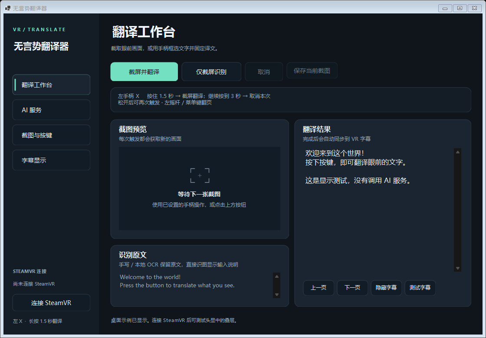

# 无言势翻译器

**無言勢翻訳機 · Mugonzei Honyakuki**

[简体中文](README.md) · [日本語](README.ja.md) · [English](README.en.md)

在 SteamVR 中看懂眼前的文字：长按手柄截屏，识别手写或印刷文字，再把译文显示在视野下方的半透明字幕条里。为无言交流场景设计，也可用于游戏内标牌、菜单与聊天文字。

[下载 Windows 版](https://github.com/pan0001/mugonzei-honyakuki/releases) · [反馈问题](https://github.com/pan0001/mugonzei-honyakuki/issues)



> 实验性 Windows x64 应用。手写识别可能误读、漏字；请结合原图核对。本项目独立于 SteamVR、VRChat 与各 AI 服务提供商。

## 可以做什么

- **手柄截图**：左手 X 长按 1.5 秒触发；视野下方的圆环显示进度。继续按到 3 秒取消本次任务并隐藏字幕。
- **字幕叠层**：扁长的半透明字幕条，支持翻页、原文对照及位置、宽度和显示时长调整。
- **AI 手写识别**：自动定位字迹，从原图裁剪放大，结合整图读取原文，再翻译；面向中、日、英及混合文字，无需手动框选。
- **直接识图**：把截图直接交给视觉模型，让模型按画面内容组织译文或简短说明。
- **本地 OCR**：Tesseract 印刷文字识别，以及独立的 NDLOCR-Lite 日语识别；识别阶段可在本机完成。
- **多种翻译服务**：已登录的 Codex、云端或本机 OpenAI 兼容 API，以及后台 Google Translate 网页。
- **账号与积分**：可连接自建积分服务器，通过爱发电购买次数包，查看订单和消费记录。完整翻译成功扣 1 积分；自备服务不消耗服务器积分。
- **可选框选**：用双手柄拉出矩形，仅翻译选区，结果固定在 SteamVR 追踪空间。
- **保留问题样本**：工作台可手动保存当前截图。自备服务不自动建立翻译历史；积分服务保存近期结果供断线恢复。

## 运行要求

- Windows x64、SteamVR，以及可通过 SteamVR 使用的头显和手柄。
- Codex 模式：已安装并登录的 Codex CLI；它会调用在线模型，不是离线推理。
- 其他 AI API：可用的兼容服务；识图需支持图片输入，AI 手写模式还需支持多图输入。
- Google Translate 网页模式：网络连接及 Microsoft Edge WebView2 Runtime。
- 便携包包含 .NET 运行时、Tesseract 语言模型与本地日语 OCR 运行时。源码构建需要 .NET 10 SDK，首次准备依赖时需要联网。

目前桌面界面主要为简体中文；本仓库提供中、日、英三语说明。

## 快速开始

1. 从 [Releases](https://github.com/pan0001/mugonzei-honyakuki/releases) 下载 Windows 压缩包，**完整解压**到可写目录。不要只复制 `.exe`。
2. 启动 SteamVR、连接头显并进入游戏，再运行 `SteamVrTranslator.exe`。首次启动会自动显示三步配置向导。
3. 第一步选择翻译服务、识图方式和目标语言。默认是本机 Codex +「本地OCR（不推荐）」，并不会自动把截图上传给模型。
4. 第二步完成 Codex、API、Google 或「积分服务（爱发电）」设置。Codex 模型可留空，思考程度默认为「自动（按阶段）」；API 必须填写地址和模型，未启用鉴权的本机服务可不填密钥；Google 仅搭配本地 OCR 或本地日语 OCR。选择积分服务时，填写运营者提供的 HTTPS 服务地址；完成向导后，在「账号与积分」注册或登录并充值。
5. 第三步选择截图来源，检查快捷键、VR 手柄设置与摘要，然后点击「保存并开始」。完成后才会打开工作台、连接 SteamVR 并启用快捷键。
6. 对准文字，按住左手 X。**1.5 秒圆环满时截屏并开始翻译**；此时松开即可等待字幕。识别和翻译另需时间，长按计时不等于总等待时间。
7. 若不需要这次翻译，继续按到 **3 秒**，第二圈满时取消并收起字幕。先松开，再次长按可获取新截图。

首次配置未完成便关闭向导时，程序会退出，下次启动再次显示向导。已有设置会自动继承，不会强制重新配置；需要修改时，可在「AI 服务」页点击「配置向导」重新打开，取消不会改变已保存的设置。首次启动以 `%LOCALAPPDATA%/SteamVrTranslator/settings.json` 是否存在判断。

「检测 Codex 登录」只检查登录状态；「测试字幕」只显示固定例句。识别按钮可先检查原文；AI 识别按钮仍会发送图片。最小化后程序留在系统托盘，关闭窗口则退出。

若提示缺少 `VCRUNTIME140.dll` 或 `MSVCP140.dll`，请安装微软的 [Visual C++ x64 Redistributable](https://aka.ms/vs/17/release/vc_redist.x64.exe)。Google 网页缺少运行时的安装说明见 [Microsoft WebView2](https://learn.microsoft.com/en-us/microsoft-edge/webview2/concepts/distribution)。

## 升级与增量更新

升级到 `0.1.1-preview` 或后续版本时，先退出旧实例，再把新版压缩包完整解压到新目录并运行。设置保存在 `%LOCALAPPDATA%/SteamVrTranslator/`，不会因更换程序目录而被覆盖，无需复制旧目录中的程序文件或重新运行首次配置。

从 Git 源码更新时，在现有仓库目录执行以下命令，再运行新生成的程序：

```powershell
git pull --ff-only
.\build.ps1
```

后续改动通过增量提交更新，并以新的版本标签发布；已发布的版本和旧标签会保留。

## 识图方式怎么选

| 方式 | 处理流程 | 图片去向 |
| --- | --- | --- |
| 本地OCR（不推荐） | Tesseract 识别，再翻译文字 | 识别留在本机；只发送原文给翻译服务 |
| 直接发送截图给模型 | 视觉模型读取并翻译，自行组织输出 | 截图发送到所选 Codex / API |
| 手写体 OCR（AI）→ 翻译 | 自动定位 → 局部放大读取 → 翻译 | 整图与细节图发送到所选 Codex / API |
| 本地日语手写 OCR → 翻译 | NDLOCR-Lite 本机识别，再翻译文字 | 识别留在本机；只发送原文给翻译服务 |

AI 手写识别通常包含两次视觉请求，翻译再增加一次文字请求，等待和用量会高于单次直接识图。模糊、遮挡或原图缺失的笔画无法靠放大恢复。NDLOCR-Lite 的日语识别能力不等于中、日、英混合手写都能正确识别。

## 配置翻译服务

### 积分服务与爱发电

在首次配置或「AI 服务」选择「积分服务（爱发电）」，填写运营者提供的 HTTPS 服务地址。保存后打开「账号与积分」注册或登录，选择次数包并在爱发电页面付款，返回后刷新订单和余额。默认本机地址 `http://127.0.0.1:5187` 仅供自行运行开发服务器，项目没有内置已经上线的收款服务。

- 完整任务成功扣 **1 积分**。图片或手写模式先识别中、日、英原文再翻译；内部多阶段仍只计一次，不输出无字场景说明。普通 OCR / 本地日语 OCR 在本机识别后只提交文字。
- 无字、失败、服务端完成前取消不扣分；服务器已完成后取消或隐藏字幕不退款。重复查同一任务不重复扣分。网络中断后可在账号窗口恢复最近任务，避免再次截图造成新任务。
- 爱发电通知只触发核验，服务器主动查询真实订单后入账。同一订单最多入账一次；金额、方案和账号关联不匹配时不自动加积分。
- 本地「仅识别」不扣积分。积分服务不开放单独的 AI 识别请求；该功能可使用自备 Codex / API。原有服务与设置保留。
- 登录令牌按服务地址隔离，并由 Windows DPAPI 保护；服务端 AI 密钥和爱发电 Token 不交给客户端。服务器保存账户、订单、消费流水及近期原文/译文，图片仅在任务处理期间使用。

服务端需要单独部署，并配置爱发电创作者/开发者权限、实际方案和 AI 服务。正式支付默认关闭；本机模拟支付不会收款，也不会调用真实 AI。部署、接口、测试和退款操作见 [服务端说明](server/README.md)。此代码独立实现官方接口，没有引入 VRCLS 或其他 AGPL 项目代码。

### Codex

使用 Codex CLI 已有登录，无需在本程序填写 API 密钥。程序路径留空会自动查找；模型留空使用 CLI 默认选择，不继承个人 `config.toml` 的模型设置，也不会接续既有聊天。

使用 Codex 识图时，可将识图方式改为「直接发送截图给模型」或「手写体 OCR（AI）→ 翻译」。如需指定模型，可填写 `gpt-6.1-terra`，但须以账号实际可用模型为准。

思考程度支持「自动（按阶段）」、`low`、`medium`、`high`。自动时，直接识图和文字翻译用 low，手写定位用 medium，多图细读用 high；显式选择后覆盖所有 Codex 识别与翻译阶段。更改后须保存。调用计入账号用量；账号权限、限额和网络均会影响可用性。

### 云端或本机 API

选择「其他 AI API」，填写 Base URL 或完整 `/chat/completions` 地址、模型名称及服务所需的密钥。支持 Chat Completions 格式的 JSON/SSE 响应；图片以 PNG data URL 的 `image_url` 发送。流式模式收齐回答后显示字幕，不逐字刷新。

可使用服务商预设，或自行填入兼容地址。本机预设为：

- Ollama：`http://localhost:11434/v1/`
- LM Studio：`http://localhost:1234/v1/`

请先自行启动本地服务并加载合适的模型。未启用鉴权时密钥可留空；本程序不自动下载或启动模型，也不会在失败时自动切换到云端。Codex 的思考程度选项不影响这些 API。

「测试图片识别」发送的是程序生成的固定测试图，不是当前游戏画面。切换服务地址时请重新填写该服务的模型和密钥；未保存的 AI 设置会阻止新的识别请求。

### Google Translate 后台网页

选择「Google Translate（后台网页）」，搭配「本地OCR（不推荐）」或本地日语 OCR。程序通过独立的 WebView2 网页填入识别文字并读取译文，无需 API 密钥；它不是 Gemini，也不是 Google Cloud Translation API。

网页默认在后台工作，不通过桌面鼠标逐字输入。「查看翻译网页」可显示页面。单次文本上限 5,000 字符；验证码、限流、访问拒绝或网页结构变化可能使翻译失败，不会绕过验证或自动换用其他服务。

## 按键与字幕

| 操作 | 默认绑定 |
| --- | --- |
| Touch / Quest 经 SteamVR 截图翻译 | 左 X 长按 1.5 秒；继续至 3 秒取消 |
| Index 截图翻译 | 左 A 长按 1.5 秒；继续至 3 秒取消 |
| Vive 截图翻译 | 右菜单键长按 1.5 秒；继续至 3 秒取消 |
| 手柄翻页 | Touch / Index：按下左摇杆；Vive：左菜单键 |
| 键盘截图翻译 | `Ctrl+Alt+T` |
| 下一页 / 上一页 | `Ctrl+Alt+→` / `Ctrl+Alt+←` |
| 显示或隐藏上次字幕 | `Ctrl+Alt+H` |

翻译快捷键被占用时，会依次尝试 `Ctrl+Alt+F8`、`Ctrl+Alt+F9`、`F8`，实际绑定见窗口底部。手柄绑定可在「截图与按键」中打开 SteamVR 绑定编辑器修改；本程序不会吞掉游戏的同名按键。

新截图会替换旧任务，取消后的迟到结果不会覆盖新字幕。截图瞬间会短暂隐藏本程序的叠层，避免圆环或字幕进入截图。

## 可选：双手柄框选

在「截图与按键」启用「双手柄框选」并保存。按住左 X，用左右手柄分别指向矩形的两个对角；**松开 X** 后按选区截图翻译。此模式取代手柄的 1.5 秒 / 3 秒长按逻辑，键盘和桌面按钮仍执行普通截图。

框固定于 SteamVR 追踪空间，不会自动跟随游戏物体、摇杆移动或传送，也没有游戏场景的深度遮挡。快速移动、追踪丢失或旧自定义动作绑定可能影响框选；关闭该选项即可恢复普通截图与下方字幕。

## 数据与隐私

- 设置保存在 `%LOCALAPPDATA%/SteamVrTranslator/`。API 密钥使用当前 Windows 用户的 DPAPI 加密；Codex 登录由 CLI 自行管理。
- 使用云端视觉模型时会发送截图；使用本地 OCR 时，只把识别文字发送给所选翻译服务。只有识别与翻译都使用本机服务时，全流程才可离线。
- Codex 和本地日语 OCR 会创建临时 PNG，正常完成、失败或取消时尝试清理；强制终止或断电可能留下临时文件。
- Google 网页使用独立的 `GoogleWebView2/` 数据目录，不共享个人浏览器登录，但会保留网站 Cookie 和缓存。
- 桌面端不自动保存截图；「保存当前截图」由用户主动操作。自备服务不自动保存译文历史；积分服务在服务器保存近期原文/译文用于找回任务，并保存订单和消费记录。开发诊断命令会另外写入图片、原文或结果报告。
- 提交 Issue 前请遮盖私人信息。不要上传设置、凭据、个人截图或完整诊断目录。

## 从源码构建

在 Windows x64 安装 .NET 10 SDK 和 Git 后：

```powershell
git clone https://github.com/pan0001/mugonzei-honyakuki.git
cd mugonzei-honyakuki
.\build.ps1
```

脚本会准备缺失的 OCR 资源、运行测试并生成自包含发布目录：`dist/SteamVrTranslator/`。本地日语运行时安装在项目私有目录，不修改全局 Python。NDLOCR-Lite 固定为 1.3.1；模型与依赖来源、校验信息见准备脚本和生成的运行时清单。

单独运行测试或 UI 演示：

```powershell
dotnet run --project tests/SteamVrTranslator.Tests.csproj -c Release
.\dist\SteamVrTranslator\SteamVrTranslator.exe --demo
```

常规自动测试使用固定样例和模拟服务。`--demo` 不自动连接 SteamVR、不调用 AI。带 `--codex-smoke`、`--vision-smoke`、`--handwriting-smoke` 等参数的诊断会调用真实模型并可能产生用量，请勿当作离线测试。

## 已知限制与反馈

手写、小字、透视、反光与复杂背景可能造成错字、漏字或混入背景文字；开发样例测试不能证明真实使用准确率。SteamVR 控制器输入、头显可读性及服务兼容性需要按实际设备确认。Google 网页模式可能随网页变化失效。

反馈时请提供程序版本、识图方式、服务名称、控制器类型与复现步骤；如果愿意提供图片，请先裁去无关或私人内容，并注明正确原文和错误结果。

## 第三方组件

主要使用 OpenVR、Vortice.Windows、Tesseract、NDLOCR-Lite、.NET 与 WebView2。各组件适用自己的许可；详情见 [THIRD-PARTY-NOTICES.md](THIRD-PARTY-NOTICES.md) 及随源码或发布包保留的许可证文件。特别是 NDLOCR-Lite 与其模型相关组件不能合并表述为单一许可证。
